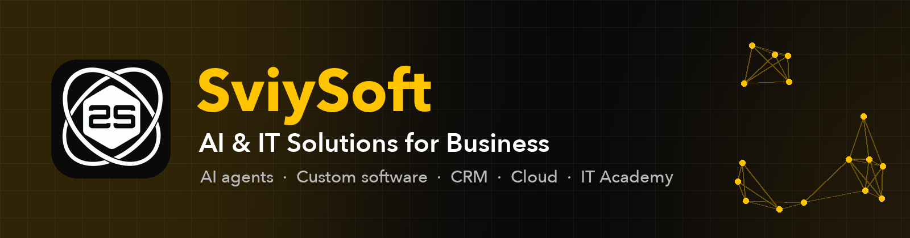

  

  
  
  
  
  
  
  
  

<h3 align="center">IT technology corporation building AI agents, custom software and cloud infrastructure for businesses worldwide.</h3>

  
  
  
  
  
  

---

## 🚀 What we do

<table>
  <tr>
    <td width="33%" valign="top">
      <h3>🤖 AI agents</h3>
      AI teams that work for your business around the clock: marketing, SEO, content, ads and customer communication.
    </td>
    <td width="33%" valign="top">
      <h3>💻 Custom software</h3>
      Websites, mobile apps for iOS and Android, CRM and ERP systems, integrations and automation, from idea to launch.
    </td>
    <td width="33%" valign="top">
      <h3>☁️ Cloud & DevOps</h3>
      High-performance VPS with NVMe, DDR5 and 10 Gbit/s in 15 locations, one-click deploy, monitoring and backups.
    </td>
  </tr>
  <tr>
    <td width="33%" valign="top">
      <h3>📊 Business software</h3>
      Ready-made products with instant delivery: SviyCRM, templates, AI agents and integrations in our marketplace.
    </td>
    <td width="33%" valign="top">
      <h3>🔐 Security</h3>
      Enterprise-grade protection, DDoS mitigation, encrypted data and a 99.9% SLA for the services we run.
    </td>
    <td width="33%" valign="top">
      <h3>🎓 IT Academy</h3>
      Practical courses on IT, AI, marketing and business from engineers who build real products every day.
    </td>
  </tr>
</table>

## 🧩 Products

| Product | What it does |
|---|---|
| [**AI Marketing OS**](https://sviysoft.com/marketing-os) | 17 specialized AI agents for content, ads, social media and email, with brand memory and auto-publishing |
| [**AI SEO OS**](https://sviysoft.com/seo-optimizer) | Technical audits, rank tracking, keyword research, competitor scans, AI briefs and a growth roadmap |
| [**SviyCRM**](https://sviysoft.com/marketplace) | CRM for orders, clients and deals |
| [**Cloud VPS**](https://sviysoft.com/services) | Fast cloud servers in 15 locations with full root access |
| [**SviySoft Academy**](https://sviysoft.com/courses) | Courses on IT, AI, marketing and business |
| [**SviySoft App**](https://sviysoft.com) | The whole platform on iOS and Android: AI teams, CRM, messenger with video calls and push notifications |

## 🛠 Tech stack

  

## 🤝 Work with us

Tell us about your idea and get a plan with timing and price within 30 minutes on business days.

  
  

---

  © SviySoft, Inc. · 1007 N Orange St, Ste 5179, Wilmington, DE 19801, USA · <a href="https://sviysoft.com">sviysoft.com</a>

